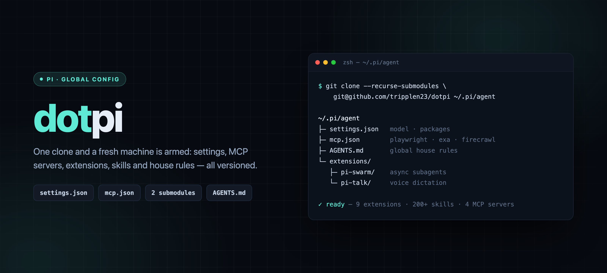
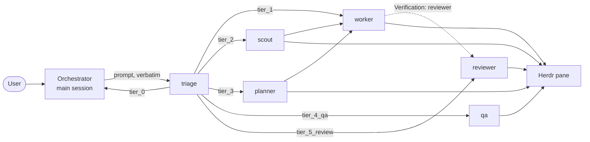

# dotpi

<p align="center">
  
</p>

Global [Pi](https://pi.dev) configuration, cloned straight into `~/.pi/agent`.

## What is personal / ignored

Secrets and machine state are in `.gitignore`: `auth.json`, `mcp-auth.json`,
`env.sh`, `trust.json`, `sessions/`, `models-store.json`, installed packages
(`git/`, `npm/`, `bin/`), and `node_modules`.

## Fresh machine setup

```bash
# 1. Clone into place (repo path == config path)
#    --recurse-submodules also fetches extensions/pi-swarm and extensions/pi-talk
#    (their own repos: tripplen23/pi-swarm, tripplen23/pi-talk)
git clone --recurse-submodules git@github.com:tripplen23/dotpi.git ~/.pi/agent

#    Already cloned without the flag? Fetch the submodule:
#    git -C ~/.pi/agent submodule update --init --recursive

# 2. Secrets: copy the template and fill in your keys
cp ~/.pi/agent/env.example.sh ~/.pi/agent/env.sh
$EDITOR ~/.pi/agent/env.sh

# 3. Source env.sh from your shell rc (zsh OR bash — the file is plain sh)
#    ~/.zshrc  or  ~/.bashrc:
[ -f ~/.pi/agent/env.sh ] && . ~/.pi/agent/env.sh

# 4. Install the packages listed in settings.json (Caveman, Ponytail) and the
#    browser extension deps
pi update --extensions
cd ~/.pi/agent/extensions/browser && npm install && npx playwright install chromium

# 5. Editor/type-check deps (optional; removes TS errors in VSCode)
npm install --prefix ~/.pi/agent
cd ~/.pi/agent/extensions/pi-swarm && npm install
cd ~/.pi/agent/extensions/pi-talk && npm install

# 6. Voice dictation (extensions/pi-talk) needs sox + a key
brew install sox                  # provides `rec`
# then set ELEVENLABS_API_KEY in env.sh (see env.example.sh)
```

## Layout

| Path | What |
|------|------|
| `settings.json` | default provider/model, `theme`, `quietStartup: "header"` (hides the startup resource listing), `images: false` (Pi hardcodes `TERM_PROGRAM=herdr` to the Kitty graphics protocol, which Terminal.app cannot render, so the payload leaks into the input line as text), `packages` list |
| `mcp.json` | MCP servers (playwright chrome/webkit, firecrawl, exa). The two HTTP headers read their key by **sourcing `env.sh`** rather than from the ambient environment, so a multiplexer holding a stale environment cannot break them, and rotating a key needs only `/mcp` instead of a restart |
| `extensions/` | `web-search-fallback.ts` (Exa → Firecrawl → Playwright), `ui/`, `triage/`, `browser/`, `bash-guard/`, `web-fetch/`, `ask-user-question.ts`, `prompt-snippets/`, `plan-mode/` |
| `env.sh` | secrets, **not committed**; template in `env.example.sh` |

Three paths are git submodules with their own repos — `extensions/pi-swarm`,
`extensions/pi-talk`, `themes/`. They are covered under Routing and Look and feel.

## Look and feel

`themes/` (the `dotpi-theme` repo) holds one JSON per theme.

```
/theme              pick from every discovered theme (current one listed first)
/theme old-money    switch directly
```

Both forms also **save** the choice as the `theme` setting, the same way
`/settings` → Theme does, so it becomes the default for the next session.

`extensions/ui/` adds a banner using Pi's own 4×4 logo mark drawn as tetris
blocks.

`/dotpi-ui` turns the pack off for the session; `/reload` brings it back.

## Routing

`extensions/triage/` classifies a request into a tier before anything is spawned, so
cheap work stays in the main session and real work fans out to the right subagent.
It registers a single `triage` tool; the routing policy lives in code, so `AGENTS.md`
only needs one line telling the orchestrator to call it first.



Every request lands in one of six tiers:

| Tier | Meaning | Route |
|---|---|---|
| `tier_0` | Talk, explain, configure, docs, status check, ship crumb | answer inline, spawn nothing |
| `tier_1` | Bounded edit whose target is named | `worker` |
| `tier_2` | Bug or tweak whose files are not named | `scout` → `worker` |
| `tier_3` | New subsystem, refactor, or an explicit ask to plan | `planner` → `worker` |
| `tier_4_qa` | Must operate a running UI to verify | `qa` |
| `tier_5_review` | Read-only code/project/security audit | `reviewer` |

`is_ui_test` and `is_code_review` are separate `noul` questions, not extra choices on
the tier, so a keyword cannot steal a route: a bug report that mentions clicking is
not a QA session, and "review the plan" is not a code review. The tool also returns
a **verification** level, so routing decides what does the checking as well as what
does the work.

Below 70% confidence on `tier_3` / `tier_4_qa` / `tier_5_review` (50% on the rest),
the result comes back flagged and the orchestrator must confirm with the user before
routing. The local heuristic is capped at 60%, so it can never clear those floors
silently.

### Which engine decides

First usable answer wins. A continuation crumb is not a classification, so it is settled
before any engine is consulted.

| # | Engine | When it runs | Correct | Latency | Cost |
|---|---|---|---|---|---|
| 0 | Crumb short-circuit | "ok", "ship it" — nothing to classify | — | ~0 | free |
| 1 | **Jev** (TypeSafe via OpenRouter) | whenever a credential resolves | **10/10** | **482 ms** | ~$0.000075/call (≈$0.45/month at 200/day) |
| 2 | **Laya** (self-hosted) | Jev absent, errored, or timed out | 2/10 | 5,827 ms | free |
| 3 | Local regex hint | both models unavailable | not a classifier | ~0 ms | free |

The regex is **not a classifier and never returns a `Triage Result`**. It is a hardcoded
rule set that only matches phrasings we anticipated; anything else falls through. When no
model answers, the tool says so and tells the orchestrator to apply the AGENTS.md routing
rules itself, with the keyword match attached as an explicitly unreliable hint. A guess
presented as a result is worse than no result, and it must never consume an
`ask_user_question`.

Every routing decision is appended to `triage.log` (gitignored), recording the tier, the
confidence, which engine answered and how long it took, so the floors and the engine
order can be re-tuned against real traffic rather than a sample.

## Skills

Pi reads skills from **`~/.agents/skills/`** (shared across Pi, OpenCode,
Claude Code, and 70+ agents via the [`skills`](https://github.com/vercel-labs/skills)
CLI) plus the git packages in `settings.json` (Caveman, Ponytail).

`~/.agents/` is **not** in this repo. Reproduce it on a new machine with:

```bash
npx skills add mattpocock/skills    --skill '*' -g -a pi -a opencode -a claude-code -y
npx skills add cloudflare/skills    --skill '*' -g -a pi -a opencode -a claude-code -y
npx skills update -g -y   # later updates
```

`~/.agents/.skill-lock.json` records installed sources; the CLI symlinks each
skill into `~/.claude/skills/` (OpenCode and Pi read `~/.agents/skills/` directly).
